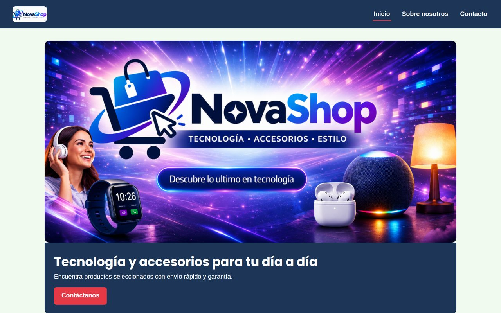
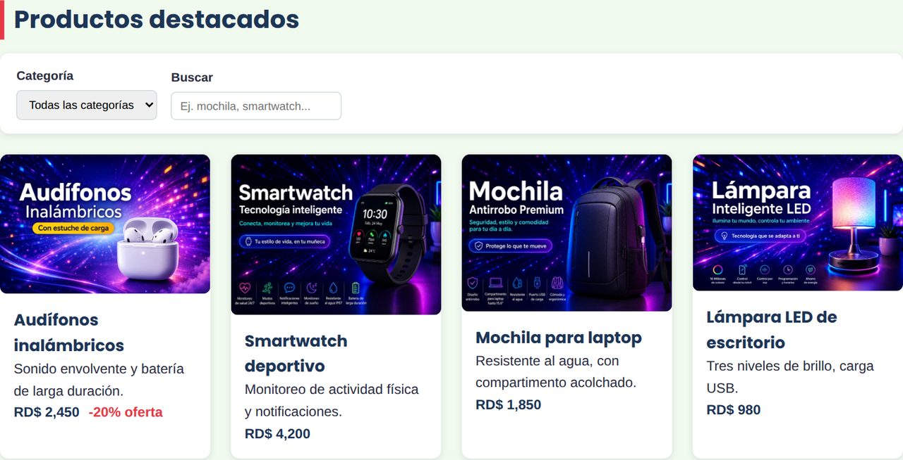
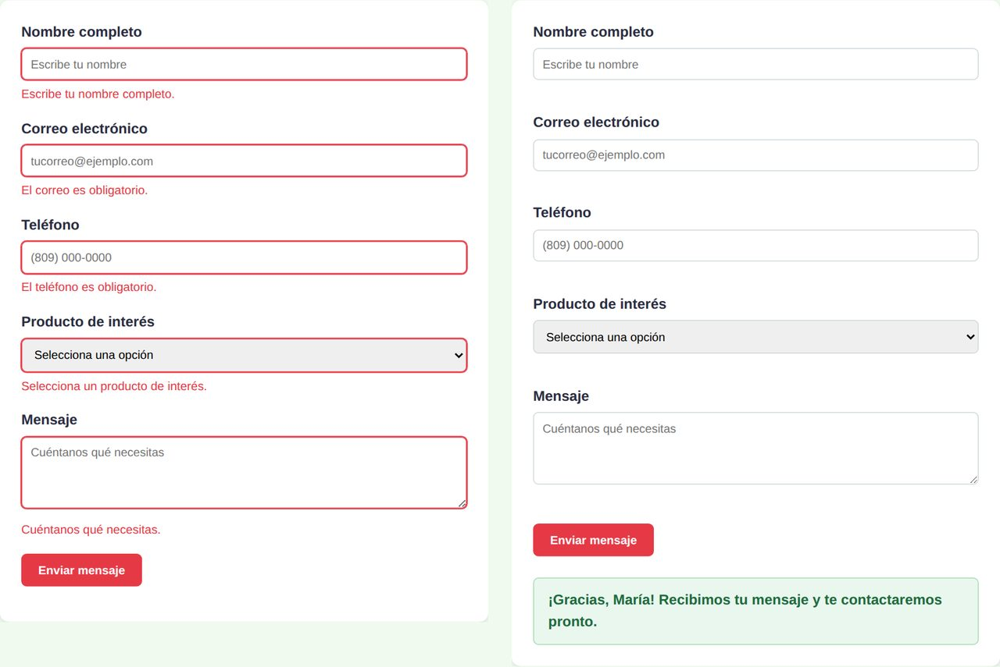
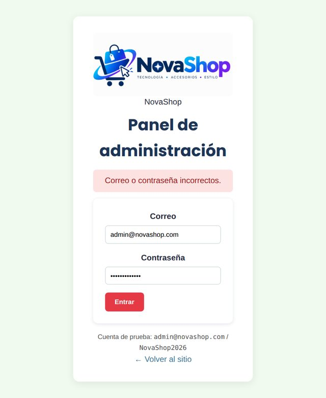
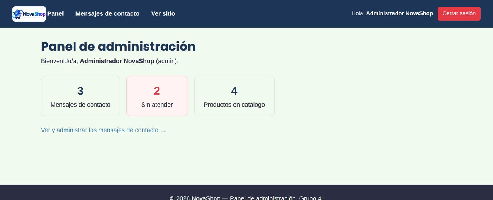
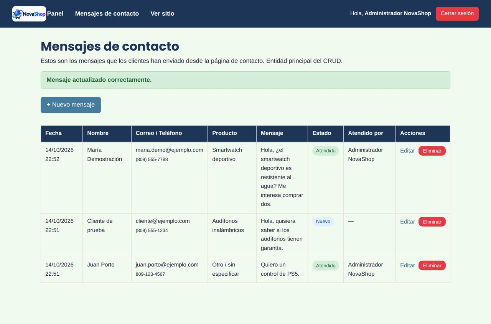
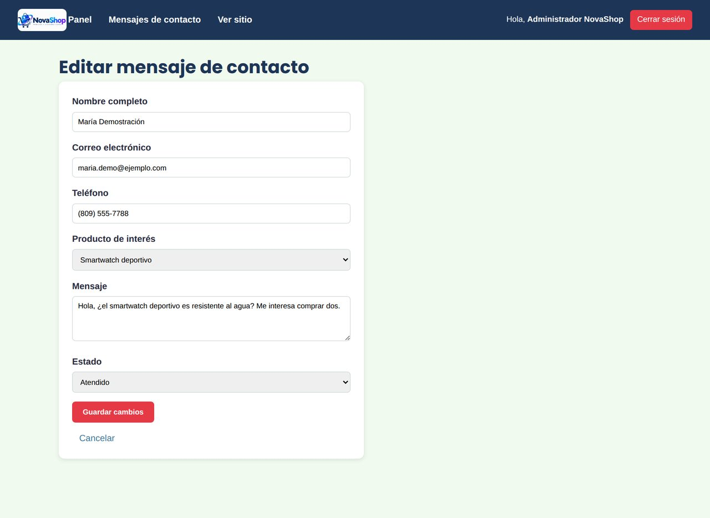

<div align="center">

# 🛍️ NovaShop

### Proyecto del Grupo 4 — Desarrollo de Aplicaciones Web (ISW306-202633)


Tienda en línea de accesorios de tecnología y hogar, desarrollada a lo largo del trimestre y migrada al framework **Laravel 12** en la fase final.

</div>

---

## 📋 Descripción

**NovaShop** es el proyecto colaborativo del Grupo 4. Empezó como un sitio estático (Fase 1), ganó interactividad con JavaScript (Fase 2), pasó a tener backend con PHP, sesiones y MySQL (Fase 3) y en la **Fase 4** se migró completo a **Laravel 12**, manteniendo toda la funcionalidad:

- 🛒 **Catálogo** de productos que sale de la base de datos, con filtro por categoría y buscador.
- ✉️ **Formulario de contacto** validado en el navegador y en el servidor, que guarda cada mensaje en MySQL.
- 🔐 **Login con sesiones** para el panel de administración (contraseñas cifradas con bcrypt, límite de intentos y protección CSRF).
- 🗂️ **CRUD de mensajes de contacto** en el panel: crear, ver, editar (marcar como atendido) y eliminar.

## 📸 Capturas

Tomadas con la aplicación corriendo en local (`php artisan serve` + MySQL) y los datos de prueba de los seeders.

| Inicio | Catálogo desde la base de datos |
|:---:|:---:|
|  |  |

**Formulario de contacto:** a la izquierda, la validación en el navegador; a la derecha, el mensaje ya guardado en MySQL.

<p align="center"></p>

| Login (contraseña incorrecta) | Panel de administración |
|:---:|:---:|
|  |  |

| CRUD: lista de mensajes | CRUD: editar un mensaje |
|:---:|:---:|
|  |  |

## 🗺️ Fases del proyecto

| Fase | Contenido | Estado |
|---|---|---|
| **Fase 1 — Maquetación** | HTML5 semántico, CSS, identidad visual | ✅ Aprobada |
| **Fase 2 — Interactividad** | JavaScript: filtro de productos y validación del formulario | ✅ Aprobada |
| **Fase 3 — Backend y datos** | Servidor local, login con sesiones, MySQL y CRUD | ✅ Aprobada |
| **Fase 4 — Framework y despliegue** | Migración a Laravel 12, instalación reproducible, versión `v4.0` | ✅ Entrega final |

## 🚀 Tecnologías y versiones

| Herramienta | Versión |
|---|---|
| PHP | 8.2 o superior (probado con PHP 8.2.12 de XAMPP) |
| Laravel | 12.x |
| Composer | 2.x |
| MySQL / MariaDB | MySQL 8 o MariaDB 10.4+ (incluido en XAMPP) |
| Frontend | HTML5, CSS3, JavaScript sin frameworks y plantillas Blade |

**¿Por qué Laravel 12 y no 13?** Laravel 13 exige PHP 8.3 y el XAMPP del equipo trae PHP 8.2. Laravel 12 funciona con PHP 8.2 y mantiene todo lo que necesitábamos.

## ✅ Requisitos de la Fase 4 y dónde se cumplen

| Requisito | Dónde está |
|---|---|
| Manejador de peticiones | [`routes/web.php`](routes/web.php): cada URL apunta a un controlador; `Route::resource` crea las rutas del CRUD y el middleware `auth` protege `/admin` |
| Inyección de dependencias | [`PanelController`](app/Http/Controllers/Admin/PanelController.php) recibe el servicio [`ResumenMensajes`](app/Services/ResumenMensajes.php) en su constructor; los controladores reciben el `Request` y los Form Requests ya validados |
| Variables de entorno | `.env` (no se sube, está en `.gitignore`) y [`.env.example`](.env.example) como plantilla sin contraseñas |
| Script SQL con datos de prueba | Migraciones + seeders (`php artisan migrate --seed`) y el script [`database/novashop.sql`](database/novashop.sql) |
| Usuario de demostración | `admin@novashop.com` / `NovaShop2026` (ver abajo) |

## 🧰 Requisitos previos

1. **XAMPP** con PHP 8.2 o superior (o PHP y MySQL instalados por separado). Comprueba la versión con `php -v`.
2. **Composer**: https://getcomposer.org/download/ — en Windows usa `Composer-Setup.exe` y, cuando pregunte por PHP, elige `C:\xampp\php\php.exe`.
3. **Git** o GitHub Desktop.
4. En `C:\xampp\php\php.ini` deben estar activas (sin `;` al inicio) las líneas `extension=zip` y `extension=fileinfo`.

## 🖥️ Instalación y ejecución local

```bash
# 1. Clonar el repositorio
git clone https://github.com/Troyj767/ISW306-202633-Desarrollo-De-Aplicaciones-Web-.git novashop
cd novashop

# 2. Instalar las dependencias de PHP (crea la carpeta vendor/)
composer install

# 3. Crear el archivo de configuración y la clave de la aplicación
copy .env.example .env        # en Linux/Mac: cp .env.example .env
php artisan key:generate
```

4. **Crear la base de datos vacía** `novashop_laravel`:
   - en phpMyAdmin: *Nueva* → nombre `novashop_laravel` → cotejamiento `utf8mb4_unicode_ci` → *Crear*;
   - o en MySQL Workbench: `CREATE DATABASE novashop_laravel CHARACTER SET utf8mb4 COLLATE utf8mb4_unicode_ci;`
5. **Revisar la conexión en `.env`.** Por defecto usa `root` sin contraseña, como un XAMPP recién instalado. Si tu MySQL tiene otro usuario o contraseña, cámbialos aquí (este archivo nunca se sube):

```env
DB_CONNECTION=mysql
DB_HOST=127.0.0.1
DB_PORT=3306
DB_DATABASE=novashop_laravel
DB_USERNAME=root
DB_PASSWORD=
```

6. **Crear las tablas y cargar los datos de prueba:**

```bash
php artisan migrate --seed
```

> 💡 **Alternativa sin Artisan:** importar [`database/novashop.sql`](database/novashop.sql) en phpMyAdmin o Workbench. El script crea la base, todas las tablas y los mismos datos de prueba.
>
> Para volver a empezar con la base limpia: `php artisan migrate:fresh --seed`.

7. **Levantar el servidor de desarrollo:**

```bash
php artisan serve
```

Abrir **http://127.0.0.1:8000**. La terminal queda ocupada mientras el sitio está abierto; para detenerlo, `Ctrl + C`.

## 🔑 Usuario de demostración

| Campo | Valor |
|---|---|
| URL del panel | http://127.0.0.1:8000/login |
| Correo | `admin@novashop.com` |
| Contraseña | `NovaShop2026` |

> ⚠️ Son credenciales de **prueba académica**. Las credenciales reales de cada equipo van en `.env`, que está en `.gitignore` y nunca se sube al repositorio.

Los seeders también cargan los **4 productos** del catálogo y **2 mensajes de contacto** de ejemplo (uno "nuevo" y otro "atendido").

## 🧭 Rutas principales

| Método | URL | Qué hace | Acceso |
|---|---|---|---|
| GET | `/` | Inicio con el catálogo de productos | Público |
| GET | `/nosotros` | Sobre nosotros | Público |
| GET / POST | `/contacto` | Formulario de contacto / guardar mensaje (JSON) | Público |
| GET / POST | `/login` | Formulario de inicio de sesión / iniciar sesión (máx. 5 intentos por minuto) | Solo sin sesión |
| POST | `/logout` | Cerrar sesión | Con sesión |
| GET | `/admin` | Panel con contadores | Con sesión |
| GET, POST, PUT, DELETE | `/admin/mensajes…` | CRUD de mensajes de contacto | Con sesión |

## 📁 Estructura principal

```
novashop/
├── app/
│   ├── Http/
│   │   ├── Controllers/
│   │   │   ├── HomeController.php        # Inicio: productos con Eloquent
│   │   │   ├── ContactoController.php    # Formulario público de contacto
│   │   │   ├── AuthController.php        # Login y logout con sesiones
│   │   │   └── Admin/
│   │   │       ├── PanelController.php   # Panel (recibe ResumenMensajes por inyección)
│   │   │       └── MensajeController.php # CRUD de mensajes
│   │   └── Requests/
│   │       ├── GuardarContactoRequest.php # Validación del formulario público
│   │       └── MensajeRequest.php         # Validación del formulario del panel
│   ├── Models/                           # Producto, MensajeContacto, User
│   └── Services/ResumenMensajes.php      # Servicio inyectado en el panel
├── bootstrap/app.php                     # Configuración de middleware
├── docs/capturas/                        # Capturas que se muestran en este README
├── database/
│   ├── migrations/                       # Estructura de las tablas
│   ├── seeders/                          # Usuario demo, productos y mensajes
│   └── novashop.sql                      # Script SQL con datos de prueba
├── public/                               # css/, js/, img/ e index.php (punto de entrada)
├── resources/views/                      # Vistas Blade: layouts, sitio público, login y panel
├── routes/web.php                        # Todas las rutas (manejador de peticiones)
├── .env.example                          # Plantilla de configuración (sin contraseñas)
└── composer.json                         # Dependencias de PHP
```

## 🛠️ Problemas comunes

| Mensaje | Solución |
|---|---|
| `'php' is not recognized…` | Agrega `C:\xampp\php` al *Path* de Windows o reinstala Composer eligiendo ese PHP, y abre una terminal nueva. |
| `The zip extension and unzip/7z commands are both missing` | Activa `extension=zip` en `C:\xampp\php\php.ini` (quita el `;`) y vuelve a abrir la terminal. |
| `could not find driver` o `Access denied for user` | Revisa las líneas `DB_` de `.env` y que MySQL esté encendido. |
| `Unknown database 'novashop_laravel'` | Crea la base vacía (paso 4) antes de `php artisan migrate --seed`. |
| `No application encryption key has been specified` | Ejecuta `php artisan key:generate`. |
| Página **419 Page Expired** al enviar un formulario | Recarga la página: el token de seguridad (CSRF) había vencido. |
| Cambios en `.env` que no se notan | Ejecuta `php artisan config:clear`. |

## 🌿 Flujo de trabajo en Git

- `main` contiene solo el trabajo aprobado de cada fase.
- Cada fase se trabajó en su propia rama (`fase-1-maquetacion`, `fase-2-javascript`, `Fase-3-Backend`, `fase-4-despliegue`) y se integró a `main` mediante Pull Request.
- Cada integrante hizo commits con sus propios cambios desde su cuenta de GitHub.
- La entrega final está marcada con la etiqueta **`v4.0`**.

## 👥 Equipo — Grupo 4

| Integrante | Aporte en la Fase 4 |
|---|---|
| Erasmo José Minaya Taveras | Coordinación; base del proyecto en Laravel (rutas, login, modelos, migraciones y CRUD); README, informe, Pull Request y versión `v4.0` |
| Winston Stevens Jiménez Reyes | Página de inicio con productos desde Eloquent |
| Luisanna Jiménez Reyes | Guardado del formulario de contacto (Form Request + CSRF) |
| Yolwim Jhongelis Merán Pérez | Tabla de mensajes del panel en Blade |
| Daniel Esmill Pérez | Vistas Blade de Nosotros y Contacto |
| Carmen Nidia Soriano Martínez | Datos de prueba (seeders) y script SQL |
| Robert Ulises Ureña Báez | Integrante |

**Facilitador:** Michael · **Tablero de ClickUp:** https://app.clickup.com/90141538889/v/l/li/901421992329

## 📝 Notas

- Nunca se suben contraseñas ni credenciales reales al repositorio: cada integrante usa su propio `.env`.
- La carpeta `vendor/` tampoco se sube; se genera con `composer install`.

---

<div align="center">

*Última actualización: 16 de octubre de 2026*

</div>
